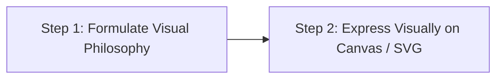

# Canvas Design Skill

Instructions for crafting distinctive visual art, posters, infographics, and canvas graphics. Output high-fidelity SVG, HTML5 Canvas, `.png`, or `.pdf` artifacts driven by deep visual craft and intentional aesthetic philosophy.

---

## 1. The Two-Step Process



### Step 1: Formulate a Visual Philosophy
Before plotting coordinates or writing SVG tags, articulate an intentional aesthetic philosophy:
1. **Name the Movement**: (e.g., *"Brutalist Precision"*, *"Chromatic Silence"*, *"Organic Geometry"*, *"Metabolist Systems"*).
2. **Define the Principles**:
   - **Space & Negative Tension**: How does breathing room emphasize the core forms?
   - **Form & Geometry**: Monumental shapes, rounded natural curves, or razor-sharp modular grids?
   - **Color Harmony**: Monochromatic with a striking punctum, earth tones with ink bleeds, or calibrated spectral intervals?
   - **Typography as Graphic**: Minimalist whispering labels vs. bold sculptural letterforms.
3. **Commit to Craftsmanship**: The final piece must look meticulously labored over by an expert visual designer—with pixel-perfect alignments, intentional rhythm, and harmonic proportions (e.g., Golden Ratio, Fibonacci scales).

---

## 2. Step 2: Visual Expression Guidelines

### A. Information Lives in the Visuals
- Treat text as a rare, precious visual accent (labels, coordinates, titles, dates).
- Never render explanatory text paragraphs onto a canvas.
- Let spatial composition, iconography, lines, and gradients communicate meaning.

### B. Technical Execution (SVG & Canvas)
* **SVG Best Practices**:
  - Use viewBox with a consistent aspect ratio (e.g., `viewBox="0 0 1200 800"` or `1080 1080` for square).
  - Group related elements using `<g>` with semantic `id` and `class` attributes.
  - Leverage gradients (`<linearGradient>`, `<radialGradient>`), clipping paths (`<clipPath>`), and subtle drop-shadow filters (`<feDropShadow>`).
  - Use high-precision curves with bezier paths (`d="M ... C ... Z"`).
* **HTML5 Canvas Best Practices**:
  - Account for device pixel ratio (`window.devicePixelRatio`) to ensure sharp rendering on Retina/HiDPI screens:
    ```javascript
    const dpr = window.devicePixelRatio || 1;
    canvas.width = width * dpr;
    canvas.height = height * dpr;
    ctx.scale(dpr, dpr);
    ```
  - Optimize draw loops: avoid recreating gradient objects or recalculating constants inside `requestAnimationFrame`.

---

## 3. Aesthetic Movements Reference

| Movement | Visual Language | Color Strategy | Typographic Stance |
| :--- | :--- | :--- | :--- |
| **Swiss Grid / International** | Mathematical columns, bold rules, modular blocks | Pure black, stark white, singular vermilion or cobalt accent | Monospace or clean grotesque, strict hierarchy |
| **Brutalist Joy** | Massive geometric volumes, heavy black borders, overlapping forms | High-energy primary accents (electric yellow, deep ultramarine) | Monumental single words, micro-labels |
| **Analog Meditation** | Soft grain, generous negative space, gentle organic curves | Wabi-sabi neutrals, stone grays, ink wash tones | Whispered small serifs with generous letter-spacing |
| **Chromatic Waves** | Smooth vector wave meshes, glowing radial contours | Deep dark background with glowing spectral transitions | Clean sans-serif, high legibility |

---

## 4. Verification Checklist

- [ ] Clear visual hierarchy (primary focal anchor, secondary guides, subtle accents).
- [ ] No generic clipart or unstyled primitive shapes.
- [ ] Proper contrast and intentional negative space balance.
- [ ] Sharp rendering across scale factors without pixelation.
