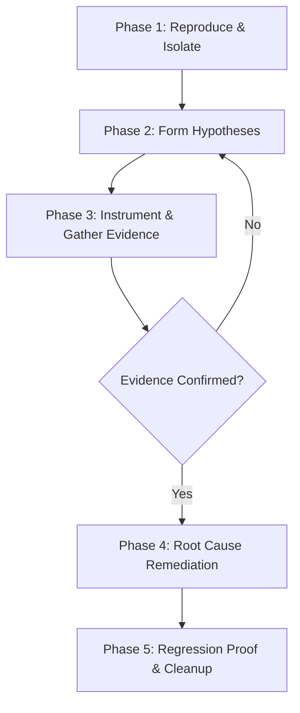

# Deep Debugger Skill

A disciplined, evidence-based methodology for diagnosing and resolving complex software defects. Avoids guesswork, premature code modifications, and "shotgun debugging."

---

## The 5-Phase Debugging Protocol



---

### Phase 1: Reproduce & Isolate
1. **Define the Problem Statement**:
   - What is the *expected* behavior?
   - What is the *actual* behavior?
   - What is the exact error message, exit code, or stack trace?
2. **Create a Minimal Reproduction (MRE)**:
   - Eliminate unnecessary dependencies, background jobs, or large datasets.
   - Craft a single command, test case, or script that triggers the failure reliably (e.g., `npm test -- -t "should handle expired session"` or `python -m pytest tests/test_auth.py -k test_token`).
   - If non-deterministic (flaky), identify environmental variables (timing, concurrency, random seed, network latency).

### Phase 2: Formulate Ranked Hypotheses
Before modifying ANY production logic, list 2–4 plausible technical hypotheses ranked by likelihood:
- **Hypothesis A**: State mutation or race condition between threads/callbacks.
- **Hypothesis B**: Boundary condition (off-by-one, null/undefined reference, unexpected type coercion).
- **Hypothesis C**: Environmental difference (configuration, permissions, library version mismatch).
- **Hypothesis D**: Upstream API/database contract violation.

For each hypothesis, document:
> *"If this hypothesis is true, observing variable X at point Y should show value Z."*

### Phase 3: Instrument & Validate
1. **Targeted Observability**:
   - Insert assertions or structured debug logs *only* at key decision boundaries:
     ```python
     # Example: Validating precondition
     assert user is not None, f"Expected authenticated user, received: {user!r}"
     logger.debug("Processing order", extra={"order_id": order.id, "status": order.status})
     ```
   - Avoid modifying unrelated functions or changing business logic during this phase.
2. **Execute and Inspect**:
   - Run the reproduction script.
   - Compare the output directly against the predictions made in Phase 2.
   - If the evidence invalidates the hypothesis, explicitly cross it off and test the next one.

### Phase 4: Targeted Root-Cause Remediation
1. **Fix the Root Cause, Not the Symptom**:
   - Do NOT simply wrap code in an empty `try/catch` or add optional chaining (`user?.profile?.settings?.theme`) if `user` was supposed to be guaranteed valid upstream.
   - Fix the broken invariant where it originates.
2. **Make the Smallest Contiguous Change**:
   - Keep the diff clean, localized, and easily reviewable.
   - Preserve existing coding conventions and type safety.

### Phase 5: Regression Proof & Cleanup
1. **Add an Automated Regression Test**:
   - Write a unit or integration test that would have failed before your fix and passes with your fix.
2. **Remove Temporary Instrumentation**:
   - Clean up debug `console.log` or `print()` statements and temporary test mocks.
3. **Verify Full Test Suite**:
   - Ensure the fix did not introduce side effects or break other tests.
